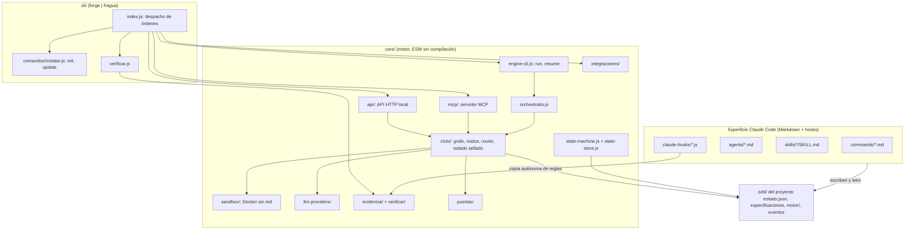
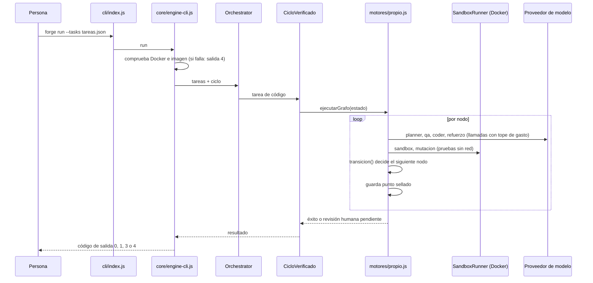

# Arquitectura

> Tipo: Explicación
> Última revisión: 2026-11-10 contra el commit 7683f83

Este documento describe cómo está organizado FORGE (paquete `fragua`): qué piezas hay, cómo se relacionan y por dónde pasan los datos. El inventario por directorio, con los módulos clave y los puntos de extensión, está en [mapa-de-modulos.md](mapa-de-modulos.md). Los conceptos (SDD, IR, constitución, ciclo verificado) están en [core-concepts.md](core-concepts.md). El estado real del proyecto —pre-beta, `5.0.0-beta.1` sin publicar— está en [ESTADO-ACTUAL.md](ESTADO-ACTUAL.md) y no se repite aquí.

---

## Dos formas de usarlo, un mismo contenido

FORGE tiene dos superficies que comparten los artefactos de `.sdd/` pero no el mecanismo de ejecución:

| Superficie | Qué la ejecuta | Qué aporta | Qué la protege |
|---|---|---|---|
| **Dentro de Claude Code** | El propio Claude Code lee los comandos de `commands/*.md`, los agentes de `agents/*.md` y las skills de `skills/` | La metodología guiada: descubrir, interpretar, especificar, planificar, implementar | Los hooks de `claude-hooks/` (guardián, memoria, convenciones) |
| **Motor propio (`forge run` / `forge resume`)** | Código de `core/` con un proveedor de modelos configurado (Anthropic, OpenAI u Ollama) | El **ciclo verificado**: implementar hasta que las pruebas pasen, en un contenedor aislado, con tope de gasto | El aislamiento con Docker, el estado sellado, los perfiles de agente |

Los comandos son texto para el modelo; no son código ejecutable. Lo que sí es código, y se prueba como tal, es `core/` y `cli/`. Las restricciones que valen para ambos (por ejemplo, «el código generado por un modelo no se ejecuta en el equipo anfitrión con el ciclo verificado activo») están en [AGENTS.md](../AGENTS.md) y, como fuente, en [.sdd/memoria/constitucion.md](../.sdd/memoria/constitucion.md).

---

## Vista de componentes

El diagrama sale de las importaciones reales entre directorios, calculadas el 2026-11-10 con un recorrido de los `import` relativos de `core/`, `cli/`, `claude-hooks/` y `ui/`. Las flechas son las principales, no todas.

**No hay una arquitectura de capas estricta.** Versiones anteriores de este documento presentaban un «modelo de seis capas» (L0 a L5) como si fuera una regla. Nada en el código ni en las pruebas lo impone, y las importaciones reales lo contradicen (por ejemplo `core/ciclo/` importa de `core/llm-providers/`, y `core/llm-providers/` importa a su vez de `core/ciclo/config.js`). Lo que sí está acotado es un puñado de dependencias prohibidas, listadas en [mapa-de-modulos.md](mapa-de-modulos.md#dependencias-entre-directorios).

---

## Proveedores de modelos

Código: [core/llm-providers/](../core/llm-providers/). El motor no fija un proveedor (restricción del proyecto): `crearProvider` lo resuelve en este orden ([index.js](../core/llm-providers/index.js)):

1. Variable de entorno `FRAGUA_LLM_PROVIDER` o `FORGE_LLM_PROVIDER`. Si las dos existen con valores distintos, no se elige ninguna ([core/entorno.js](../core/entorno.js)).
2. `llm.provider` en `.sdd/sdd.config.yaml`.
3. Detección por entorno: `ANTHROPIC_API_KEY` o `CLAUDE_API_KEY` dan `anthropic`; `OPENAI_API_KEY` da `openai`; `OLLAMA_BASE_URL` da `ollama`.
4. Si no hay nada, `anthropic`.

| Nombre | Alias aceptados | Modelo por nivel (`alto` / `medio` / `economico`) |
|---|---|---|
| `anthropic` | `claude` | `claude-opus-4-8` / `claude-sonnet-4-6` / `claude-haiku-4-5-20251001` |
| `openai` | `gpt`, `codex`, `azure`, `github-models`, `cursor` | `gpt-4o` / `gpt-4o-mini` / `gpt-4o-mini` |
| `ollama` | `local`, `deepseek`, `llama` | `deepseek-r1:14b` / `qwen2.5-coder:7b` / `llama3.2:3b` |
| `stub` | `test` | Respuestas fijas para pruebas; ninguna llamada real |

Los niveles son neutrales (`alto`, `medio`, `economico`) y los nombres heredados `opus`, `sonnet`, `haiku` valen como alias equivalentes ([niveles.js](../core/llm-providers/niveles.js)). Los modelos concretos pueden fijarse por proyecto con la sección `modelos:` de la configuración (ADR-19). Google Gemini no tiene proveedor propio en `core/llm-providers/`. El proveedor `openai` admite una `base_url` alternativa (servidores compatibles con OpenAI), pero solo si el propio usuario la permite en su entorno.

Un archivo del proyecto no puede dirigir la clave a otro servidor: `sanearConfigDelProyecto` descarta `api_key`, `api_version` y cualquier `base_url` que el usuario no haya permitido (`FORGE_LLM_HOSTS` o `OPENAI_BASE_URL` / `OLLAMA_BASE_URL`). Añadir un proveedor: [guia-anadir-proveedor.md](guia-anadir-proveedor.md).

Conformidad: la batería común `tests/proveedores-conformidad.test.js` se ejecuta contra servidores falsos, sin red ni claves, y es el criterio de aceptación de un proveedor. **Ninguno se ha probado con las funciones nuevas de 5.0 usando un modelo real** ([ESTADO-ACTUAL.md](ESTADO-ACTUAL.md)).

---

## Estado y memoria

Cuatro tipos de estado, con dueños distintos:

| Estado | Dónde | Quién lo escribe |
|---|---|---|
| Etapa del pipeline | `.sdd/estado.json` | `core/state-store.js` y `core/state-machine.js` (9 estados, 8 transiciones con guardas); véase [core-concepts.md](core-concepts.md#etapas-comandos-y-estados) |
| Eventos | `.sdd/events.jsonl` | `core/event-log.js`, de solo adición. Lo leen el panel y `forge mantenimiento` |
| Estado del ciclo | `.sdd/motor/sesion.json` y, por sesión, `.sdd/motor/<sesión>/` (`checkpoints/<hilo>/NNNNNN.json`, `diario/`, `gasto.jsonl`, `tope.json`, `respaldo/`, `mutacion/`) | `core/ciclo/`. Cada punto de guardado se escribe de forma atómica y lleva su huella; la sesión y los puntos llevan además un sello HMAC con una clave que vive **fuera del proyecto** ([sello.js](../core/ciclo/sello.js)) |
| Memoria de agentes y observabilidad | `.sdd/memoria/`, `.sdd/observabilidad/` | Los hooks de Claude Code; véase [runtime.md](runtime.md) |

Dos consecuencias de diseño que conviene conocer:

- Un estado sin sello válido **se ignora** y la tarea empieza de cero. Es lo que impide que un repositorio traiga un estado fabricado, y también por qué un estado guardado en otro equipo, o tras perder la clave, no se puede reanudar ([ESTADO-ACTUAL.md](ESTADO-ACTUAL.md)).
- El ciclo guarda un punto tras cada nodo. Si el proceso se corta, al reanudar solo se repite el nodo en curso; un diario de llamadas ([diario.js](../core/ciclo/diario.js)) evita pagar dos veces una respuesta del modelo ya recibida.

El almacén de decisiones ([core/decisions/decision-store.js](../core/decisions/decision-store.js)) y la recuperación de contexto ([core/recuperacion/](../core/recuperacion/), [memoria-semantica.md](memoria-semantica.md)) son piezas separadas del estado del pipeline.

---

## Orquestación

Dos piezas:

**El motor de tareas**, [core/orchestrator.js](../core/orchestrator.js), recibe una lista de tareas con dependencias y las ejecuta por niveles topológicos. Sin ciclo verificado, ejecuta en paralelo cuando hay `parallelThreshold` (3) o más tareas pendientes en un nivel; con ciclo verificado las tareas de código se ejecutan en secuencia. Si el nivel de ejecución global es `sandbox` (véase «Circuit breaker»), omite la tarea con un error.

**El ciclo verificado**, [core/ciclo/](../core/ciclo/), que el orquestador invoca para cada tarea de código. Sus nodos y transiciones, leídos de `grafo.js`, están en [mapa-de-modulos.md](mapa-de-modulos.md#el-ciclo-verificado-nodos-y-transiciones). Tres propiedades de diseño:

- **El grafo se decide con funciones puras.** `transicion` (en `grafo.js`) y `decidirRuta` / `decidirTrasMutacion` (en `router.js`) dependen del código de salida y del estado, nunca del texto de una salida ni de un modelo.
- **Un solo motor, sin dependencias.** `motores/propio.js` recorre el grafo nodo a nodo y guarda un punto tras cada uno. LangGraph.js se retiró en 5.0.0 (ADR-18); una configuración antigua con `motor.grafo: langgraph` funciona con un aviso.
- **La salida de los agentes son archivos, no texto libre.** Los agentes devuelven un bloque JSON `{ "archivos": [...] }` y un único punto, `aplicarArchivos` ([protocolo-archivos.js](../core/ciclo/protocolo-archivos.js)), decide qué se escribe, dónde y con qué contenido (ADR-07).

**Circuit breaker.** [core/execution-context.js](../core/execution-context.js) cuenta fallos consecutivos de tareas (por defecto, 2 por agente) y degrada un único nivel *global* de ejecución —`confirmado`, `local`, `sandbox`— que se persiste en `.sdd/execution-level.json`. El guardián de hooks lee ese archivo: en nivel `sandbox` bloquea toda ejecución de `Bash` y las escrituras fuera del proyecto. Una versión anterior de este documento hablaba de un nivel por agente; el nivel es global, aunque los contadores de fallos sí son por agente.

**Reintentos.** Las llamadas a los modelos se reintentan con espera creciente (hasta 3 intentos; un tiempo agotado se reintenta como mucho una vez) en [core/agent-registry.js](../core/agent-registry.js). El orquestador en sí no reintenta tareas: lo hace el ciclo, que repite `coder` y `sandbox` hasta `motor.max_iteraciones` (5 por defecto).

### Agentes

Los 14 agentes están en [agents/](../agents/). Son Markdown: una cabecera (`name`, `description`, `model` entre `opus`, `sonnet`, `haiku`, y `tools`) y un cuerpo que es el prompt de sistema. `AgentRegistry` los carga y los interpreta ([agent-registry.js](../core/agent-registry.js)). Hay dos hechos que se prestan a confusión:

- **`tools:` es una solicitud, no una concesión.** El ciclo verificado no la impone. Lo que cada rol puede hacer lo fija un *perfil por rol* (`planner`, `qa`, `coder`) en [core/ciclo/perfiles.js](../core/ciclo/perfiles.js); el perfil es del rol del nodo, no del agente, porque el implementador lo elige el repositorio con `tarea.agente`. El proyecto solo puede apretar el perfil.
- **Siete agentes son de solo lectura en el guardián de Claude Code:** `arquitecto`, `asesor-datos`, `critico`, `seguridad`, `investigador`, `revisor` y `disenador-api` (`READ_ONLY_AGENTS` en [pre-tool-guard.js](../claude-hooks/pre-tool-guard.js)). Esa restricción solo existe cuando se trabaja dentro de Claude Code con `CLAUDE_AGENT_NAME` definida; si la variable falta, el hook lo avisa y las guardas por agente quedan desactivadas.

---

## Gobernanza dentro de Claude Code

Los hooks de [claude-hooks/](../claude-hooks/) se describen en [hooks.md](hooks.md) (inventario y registro) y [runtime.md](runtime.md) (comportamiento). El guardián `pre-tool-guard.js` es la pieza de seguridad: falla cerrado, y aun así el propio código lo califica de «red de seguridad, no un límite». Para el modelo de amenazas y lo que se garantiza, véanse [SECURITY.md](../SECURITY.md) y [GARANTIAS-Y-LIMITES.md](GARANTIAS-Y-LIMITES.md).

Una pieza de código sin uso: [core/quality-gate.js](../core/quality-gate.js) (la clase `QualityGate`: pruebas, lint y criterio) no se importa desde ningún otro módulo de `core/`, `cli/`, `claude-hooks/`, `ui/` ni desde las pruebas (búsqueda de importaciones, 2026-11-10). Las puertas de calidad que sí intervienen en el ciclo son las de [core/puertas/](../core/puertas/) ([puertas-de-calidad.md](puertas-de-calidad.md)).

---

## Interfaces hacia fuera

| Interfaz | Código | Para qué | Documento |
|---|---|---|---|
| CLI `forge` / `fragua` | [cli/index.js](../cli/index.js) | Instalar, diagnosticar, lanzar y reanudar el ciclo, verificar, aprobar | `forge help` |
| Servidor MCP por stdin/stdout | [core/mcp/](../core/mcp/) | Que otro agente use las herramientas del ciclo. Perfil `completo` (`ejecutar_pruebas`, `leer_archivo`, `escribir_archivo`) o `verificacion` (solo `verificar`, sin gasto) | [servidor-mcp.md](servidor-mcp.md), [mcp-verificar.md](mcp-verificar.md) |
| API HTTP local | [core/api/servidor.js](../core/api/servidor.js) | Lanzar y decidir tareas del ciclo desde un programa. Solo `127.0.0.1`, con token, rechaza peticiones con `Origin` y `Host` ajenos, sin CORS | [api-http.md](api-http.md) |
| Panel de observación | [ui/server.js](../ui/server.js) | Panel de solo lectura sobre `.sdd/` con actualizaciones por SSE. Solo `127.0.0.1`; se cierra tras 30 minutos sin peticiones | [runtime.md](runtime.md#el-panel-uiserverjs) |
| Integraciones externas | [core/integraciones/](../core/integraciones/) | GitHub, GitLab y Jira con tres operaciones fijas (leer, comentar, proponer un cambio); sin operación genérica de API. Probadas solo contra servidores falsos | [integraciones-externas.md](integraciones-externas.md) |
| Esquemas del contrato público | [docs/contrato/](contrato/) | Formatos versionados; una prueba falla si el código se aparta | [contrato/](contrato/) |

El servidor MCP **no** es una capa interna del ciclo: los nodos llaman directamente a `aplicarArchivos` y a `SandboxRunner`, sin cliente MCP (ADR-15).

---

## Flujo de datos de `forge run`

Códigos de salida de `forge run` y `forge resume` ([core/engine-cli.js:41](../core/engine-cli.js)): `0` completado, `1` fallo, `3` revisión humana pendiente, `4` aislamiento no disponible. Con el código `3`, `forge resume --decision continuar|aceptar|abortar` aplica la decisión; sin decisión, no se gasta nada.

---

## Observabilidad

Archivos de registro escritos por el código, todos de solo adición:

| Archivo | Lo escribe | Contenido |
|---|---|---|
| `.sdd/events.jsonl` | `core/event-log.js` | Transiciones del pipeline y eventos del ciclo (`ciclo:nodo_completado`, `ciclo:ejecucion`, `ciclo:revision_decidida`, etc.) |
| `.sdd/motor/<sesión>/gasto.jsonl` | `core/ciclo/diario.js` | Libro de gasto del ciclo |
| `.sdd/observabilidad/consumo.jsonl` | `agent-memory.js` (hook) | Una línea por escritura, con una **estimación** de tokens por tamaño |
| `.sdd/observabilidad/mutaciones.jsonl` | `agent-memory.js` (hook) | Cada escritura o edición con agente y archivo |
| `.sdd/observabilidad/agent-tool-audit.jsonl` | `pre-tool-guard.js` (hook) | Herramientas intentadas por cada agente, con el comando recortado y sin secretos |
| `.sdd/observabilidad/dlq.jsonl` | `pre-tool-guard.js` (hook) | Los bloqueos del guardián que pasan por su función `bloquear` (no todas las salidas con código 2 la usan) |

El gasto del ciclo (`gasto.jsonl`) usa los recuentos de tokens que devuelve el proveedor y una lista interna de precios; el de `consumo.jsonl` es una estimación del hook. Son cifras distintas con fuentes distintas.

---

## Directorios que no son motor

`commands/`, `agents/`, `skills/` y `plantillas/` son la metodología en Markdown. `presets/` son tres configuraciones iniciales (`lean`, `startup`, `enterprise`) que declaran qué agentes están activos y con qué modelo. `skills-generadas/` se produce con `npm run generar-skills` a partir de `commands/` (una skill por comando) para instalar en otras herramientas; no se edita a mano y una prueba detecta la divergencia. `.sdd/` en este repositorio contiene las propias especificaciones, decisiones y constitución del proyecto.
