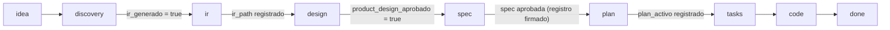

# Conceptos fundamentales

> Tipo: Explicación
> Última revisión: 2026-11-10 contra el commit 7683f83

Este documento explica los conceptos sobre los que se apoya FORGE (paquete `fragua`, comando `forge` o `fragua`): qué es una especificación, cómo se avanza por el pipeline, qué hace distinto al ciclo verificado y qué papel tienen los hooks. Es una explicación, no una referencia: los formatos exactos están en los esquemas de [contrato/](contrato/) y en [api-reference.md](api-reference.md).

El estado real del proyecto (pre-beta, `5.0.0-beta.1` sin publicar, qué está probado y qué no) está en [ESTADO-ACTUAL.md](ESTADO-ACTUAL.md). Aquí no se repiten sus cifras.

---

## Índice

1. [Desarrollo guiado por especificaciones (SDD)](#desarrollo-guiado-por-especificaciones-sdd)
2. [El requisito interpretado (IR)](#el-requisito-interpretado-ir)
3. [La constitución del proyecto](#la-constitución-del-proyecto)
4. [Etapas, comandos y estados](#etapas-comandos-y-estados)
5. [El estado del pipeline](#el-estado-del-pipeline)
6. [El ciclo verificado](#el-ciclo-verificado)
7. [Lo que un repositorio ajeno no puede decidir](#lo-que-un-repositorio-ajeno-no-puede-decidir)
8. [Memoria de agentes](#memoria-de-agentes)
9. [Los hooks de Claude Code](#los-hooks-de-claude-code)
10. [Perfiles y modos de sesión](#perfiles-y-modos-de-sesión)
11. [Despacho paralelo de agentes (PTC)](#despacho-paralelo-de-agentes-ptc)
12. [Registros de decisiones de arquitectura (ADR)](#registros-de-decisiones-de-arquitectura-adr)

---

## Desarrollo guiado por especificaciones (SDD)

**SDD (Spec-Driven Development)** es la metodología que organiza el trabajo en FORGE: primero una especificación escrita y aprobada por una persona, después el plan, las tareas y el código. En este repositorio la regla está en [AGENTS.md](../AGENTS.md): «Todo cambio empieza por una especificación» y «Ningún agente ni comando marca una aprobación por su cuenta».

Una especificación contiene criterios de aceptación, escenarios de usuario, restricciones y una definición de «hecho». La razón de exigirla es reducir la ambigüedad antes de implementar: un agente que trabaja contra criterios precisos produce algo que se puede comprobar; uno que trabaja contra instrucciones vagas, no.

La aprobación es una operación real del CLI, no una convención. `forge aprobar spec` exige un terminal interactivo y que la persona teclee un código de un solo uso; deja el registro (quién, cuándo, qué y el hash del archivo) en `.sdd/aprobaciones.jsonl` ([cli/comandos/aprobar.js](../cli/comandos/aprobar.js)). Límite documentado en ese mismo archivo: con el mismo usuario del sistema operativo no hay separación criptográfica total entre la persona y un agente.

---

## El requisito interpretado (IR)

El **IR (Interpreted Requirement)** es la primera transformación estructurada de una idea en lenguaje natural. Lo produce `/sdd.interpretar` y se guarda en `.sdd/ir.json`. Su forma está definida por [core/schemas/ir.schema.json](../core/schemas/ir.schema.json) (versión de esquema `1.0`).

Campos obligatorios del esquema: `schemaVersion`, `id`, `created_at`, `raw_input`, `confidence`, `product`, `features`, `constraints`, `assumptions`, `ambiguities` y `requires_clarification`.

```json
{
  "schemaVersion": "1.0",
  "id": "ir-2026-06-21-abc123",
  "created_at": "2026-06-21T10:00:00Z",
  "raw_input": "quiero un gestor de tareas para equipos",
  "confidence": 0.87,
  "product": {
    "name": "TaskFlow",
    "type": "saas",
    "tagline": "Gestión de tareas colaborativa",
    "value_proposition": "...",
    "target_users": "Equipos de desarrollo de 5 a 20 personas"
  },
  "features": {
    "core": ["crear tareas", "asignar a miembros"],
    "nice_to_have": ["integración con Slack"]
  },
  "constraints": { "timeline": "MVP en 4 semanas", "tech_preference": "Node.js + React" },
  "assumptions": ["el usuario tiene correo corporativo"],
  "ambiguities": [
    { "field": "notificaciones", "issue": "no se dice el canal", "resolution": "pendiente" }
  ],
  "requires_clarification": true
}
```

El esquema exige entre 2 y 5 funciones en `features.core`, y `product.type` es uno de `saas`, `mobile`, `web`, `api`, `cli`, `other`. Cada elemento de `ambiguities` lleva `field`, `issue` y `resolution`.

### La puntuación de confianza

`confidence` (0 a 1) es orientativa. **No es una guarda de la máquina de estados**: la transición `discovery → ir` solo comprueba que `ir_generado` sea verdadero ([core/state-machine.js](../core/state-machine.js)). El comando `/sdd.interpretar` recomienda aclarar (`/sdd.aclarar`) cuando `confidence < 0.7`; esa recomendación vive en el texto del comando, no en el código del motor.

Que el IR sea inmutable una vez aprobado, como se afirmaba en versiones anteriores de este documento: **no verificado**. No hay en `core/` ningún código que lo impida.

---

## La constitución del proyecto

La **constitución** es el documento de principios del proyecto. Se guarda en `.sdd/memoria/constitucion.md` (la plantilla es [plantillas/constitucion.md](../plantillas/constitucion.md)) y se crea con `/sdd.constitucion`. Este repositorio tiene la suya: [.sdd/memoria/constitucion.md](../.sdd/memoria/constitucion.md), de la que [AGENTS.md](../AGENTS.md) es un resumen.

### Qué hace el código con ella

Se ha comprobado qué lee de verdad el código, porque es menos de lo que sugiere el nombre:

- `claude-hooks/post-write-conventions.js` extrae de la constitución tres cosas, con expresiones regulares: un límite de longitud de función, una cobertura mínima y los patrones prohibidos escritos como `NUNCA`, `PROHIBIDO` o `NO USAR` seguidos de un fragmento entre comillas invertidas. Si un archivo de código recién escrito contiene un patrón prohibido, el hook termina con código 2 y un mensaje. Es un hook `PostToolUse`: el archivo ya está escrito; el código 2 devuelve el mensaje al agente para que lo corrija. Que el hook «revierta» la escritura, como decía una versión anterior de este documento, no es cierto ([post-write-conventions.js:295-298 y 411](../claude-hooks/post-write-conventions.js)).
- Los agentes `critico` y `seguridad` la mencionan en sus instrucciones ([agents/critico.md](../agents/critico.md), [agents/seguridad.md](../agents/seguridad.md)). Es una instrucción al modelo, no un control del motor.
- Lo que el motor sí impone sin depender de un modelo son los patrones prohibidos de los ADR aceptados (véase [ADR](#registros-de-decisiones-de-arquitectura-adr)).

Cuando la constitución prohíbe algo, la forma fiable de que se cumpla es expresarlo como patrón prohibido (hook) o como prueba (ciclo verificado), no solo como prosa.

### Ejemplo de contenido

```markdown
# Constitución — TaskFlow

## Stack
- Backend: Node.js 20 + Fastify
- Tests: Vitest

## Principios
- Sin dependencias no aprobadas en esta constitución
- Sin secretos en el código fuente

## Prohibido
- NUNCA: `eval(`
- NUNCA: `console.log`
```

---

## Etapas, comandos y estados

Tres niveles de granularidad distintos usan palabras parecidas. Conviene separarlos.

### Etapas (conceptuales)

Especificación, diseño, implementación, verificación y despliegue. Es la forma de hablar del flujo; no existe como estructura en el código.

### Comandos

Los comandos `/sdd.*` son archivos Markdown en [commands/](../commands/) con instrucciones para el modelo; no son código ejecutable. El camino principal es: `/sdd.descubrir`, `/sdd.interpretar`, `/sdd.diseñar`, `/sdd.especificar`, `/sdd.planificar`, `/sdd.tareas`, `/sdd.implementar` y `/sdd.desplegar` (la lista numerada del [glosario](GLOSARIO.md) es la que vigila `tests/consistencia-cifras.test.js`). `/sdd.aclarar` y `/sdd.verificar` son comandos adicionales. Un perfil de instalación (`esencial` por defecto, `completo`) decide cuántos comandos se copian al proyecto ([core/instalacion/perfiles.js](../core/instalacion/perfiles.js)).

### Estados de la máquina

`estado.json → pipeline_step` toma uno de **nueve** valores, definidos por [core/state-machine.js](../core/state-machine.js) y el esquema [core/schemas/estado.schema.json](../core/schemas/estado.schema.json):



Hay ocho transiciones, todas hacia delante. Una versión anterior de este documento (y el [glosario](GLOSARIO.md), que conviene corregir) hablaba de 11 estados con `aclaracion` y `verificacion`: esos valores no existen en la máquina. `aclarar` y `verificar` son comandos, no estados.

Particularidades comprobadas en el código:

- `spec → plan` exige una spec activa (`spec_activa`, `especificacion_activa` o `spec_draft_path`), `spec_aprobado` verdadero **y** que el registro firmado de la aprobación se verifique (`opciones.verificarSpec`). Sin verificador, la transición falla cerrada.
- Saltarse una guarda exige `--force` con un motivo de al menos 10 caracteres, y deja un evento firmado en el registro (`pipeline_step_forzado`) antes de escribir el estado.
- Si falta `pipeline_step`, la máquina lo deduce de `fase_actual` con una tabla de traducción (`descubrimiento`, `especificacion`, `tareas_generadas`, `implementacion`, `implementacion_completa`).
- Desde la terminal: `forge status`, `forge step <paso>`, `forge validate` y `forge state` ([cli/index.js](../cli/index.js)); `forge reset --force` devuelve el pipeline a `idea`.

---

## El estado del pipeline

El estado del pipeline es la fuente de verdad sobre dónde está el proyecto: `.sdd/estado.json`. Campos del esquema (todos opcionales salvo `schemaVersion`): `pipeline_step`, `ultima_actualizacion`, `ir_generado`, `ir_path`, `product_design_generado`, `product_design_aprobado`, `product_design_path`, `design_direction`, `design_system_path`, `spec_draft_path`, `spec_activa`, `plan_activo` y `artefactos_sesion` (con `ir_confidence`, `stack_decidido`, `complejidad_estimada`, `agentes_activos_ultimo_plan`).

Hay además dos estados de tareas con propósito distinto:

- `.sdd/especificaciones/<id>/.estado-tareas.json`: el punto de reanudación de `/sdd.implementar` cuando lo conduce Claude Code ([commands/sdd.implementar.md](../commands/sdd.implementar.md)). Lo gestiona el comando, y [core/checkpoint.js](../core/checkpoint.js) lee y escribe `ultima_tarea_completada`.
- `.sdd/motor/`: el estado del motor del ciclo verificado (`forge run` / `forge resume`). Es otro mecanismo, con sello (véase abajo).

---

## El ciclo verificado

Es el cambio central de la serie 5.0. En vez de pedir una vez al modelo que escriba una tarea, `forge run` repite un ciclo hasta que las pruebas pasan o hasta que hace falta una persona. Desde 5.0.0 es el modo por defecto (`motor.modo: ciclo` en [core/ciclo/config.js](../core/ciclo/config.js)); el modo antiguo exige pedirlo (`--motor clasico`) y avisa de que ejecuta en el equipo, sin aislamiento.

Las ideas que lo definen:

1. **El veredicto lo decide un código de salida, no un modelo.** Las rutas del grafo salen de funciones puras sobre el código de salida y el estado ([core/ciclo/router.js](../core/ciclo/router.js)). Esa es una restricción del proyecto ([AGENTS.md](../AGENTS.md)).
2. **El código generado se ejecuta aislado.** Las pruebas corren en un contenedor sin red, sin privilegios y con límites ([core/sandbox/](../core/sandbox/)). Si Docker no está disponible, `forge run` se detiene con el código 4; no degrada a ejecutar en el equipo.
3. **Rojo obligatorio.** El agente de pruebas escribe las pruebas y se comprueba que *fallan* sin implementación. Unas pruebas que ya pasan se rehacen una vez; si siguen pasando, se pide revisión.
4. **Medición de las pruebas por mutación.** Tras un pase se alteran líneas del código escrito y se mide cuántas alteraciones detectan las pruebas. Con `motor.mutacion: informar` (valor por defecto) solo se registra; con `exigir` un resultado bajo manda a reforzar las pruebas y, si no basta, a revisión humana.
5. **Puertas de calidad opcionales.** Tipos, linter, seguridad y cobertura se declaran en `sdd.config.yaml`; si una falla, la tarea vuelve al implementador ([puertas-de-calidad.md](puertas-de-calidad.md)).
6. **Revisión humana explícita.** Un tope de iteraciones, el gasto agotado, un fallo del entorno o un «pase sospechoso» detienen el ciclo hasta que alguien decide `continuar`, `aceptar` o `abortar` (`forge resume --decision ...`). Mientras no hay decisión no se gasta nada.
7. **Tope de gasto por sesión**, con los precios de una lista interna ([core/precios.js](../core/precios.js)). La comparación del gasto calculado con la factura real no se ha hecho ([ESTADO-ACTUAL.md](ESTADO-ACTUAL.md)).

El diagrama de nodos y transiciones, leído de [core/ciclo/grafo.js](../core/ciclo/grafo.js), está en [mapa-de-modulos.md](mapa-de-modulos.md#el-ciclo-verificado-nodos-y-transiciones). La descripción de uso, en [ciclo-verificado.md](ciclo-verificado.md). Lo que garantiza y lo que no, en [GARANTIAS-Y-LIMITES.md](GARANTIAS-Y-LIMITES.md).

---

## Lo que un repositorio ajeno no puede decidir

Un proyecto puede venir de un tercero. La revisión de seguridad de 5.0 siguió un patrón: *un archivo del proyecto no decide nada que proteja al usuario*. Los mecanismos, cada uno con su módulo:

| Mecanismo | Qué impide | Dónde |
|---|---|---|
| Estado sellado | Que un repositorio traiga un punto de guardado o una sesión fabricados y se presente como «verificado». El sello es un HMAC-SHA256 con una clave del usuario, fuera del proyecto; sin sello válido el estado se ignora y la tarea empieza de cero | [core/ciclo/sello.js](../core/ciclo/sello.js) |
| Perfiles de agente | Que el proyecto amplíe las herramientas, rutas o topes de un rol (`planner`, `qa`, `coder`). El proyecto solo puede apretar; lo que intente ampliar se ignora y se avisa | [core/ciclo/perfiles.js](../core/ciclo/perfiles.js) |
| Saneado de `llm:` | Que `sdd.config.yaml` envíe la clave del modelo a otro servidor (`base_url`, `api_key`) | [core/llm-providers/index.js](../core/llm-providers/index.js) |
| Topes del entorno | Subir CPU, memoria, tiempo o gasto desde un archivo del proyecto | [core/ciclo/config.js](../core/ciclo/config.js), [core/puertas/config.js](../core/puertas/config.js) |
| Delimitador de datos ajenos | Que el contenido del proyecto llegue al modelo como instrucciones | [core/ciclo/dato-no-confiable.js](../core/ciclo/dato-no-confiable.js) |
| Control de salida | Que el modelo escriba secretos, rutas fuera del proyecto o configuración de calidad protegida | [core/ciclo/control-salida.js](../core/ciclo/control-salida.js), [core/evidencia/protegidos.js](../core/evidencia/protegidos.js) |
| Cadena de evidencia | Retocar después un informe de `forge verificar --registrar`: cada informe lleva el hash del anterior y una firma con la clave local | [core/evidencia/cadena.js](../core/evidencia/cadena.js), [cadena-de-evidencia.md](cadena-de-evidencia.md) |
| Guardián de hooks | Que un agente edite el propio guardián, `.git/` o los ajustes de hooks | [claude-hooks/pre-tool-guard.js](../claude-hooks/pre-tool-guard.js) |

Los límites (secretos partidos o en base64 que no se detectan, firma simétrica que el mismo usuario del sistema podría leer, estado no portable entre equipos) están en [GARANTIAS-Y-LIMITES.md](GARANTIAS-Y-LIMITES.md) y [ESTADO-ACTUAL.md](ESTADO-ACTUAL.md).

---

## Memoria de agentes

El hook `agent-memory.js` (`PostToolUse` sobre `Write|Edit`) guarda, tras cada escritura, qué agente tocó qué archivo. Se identifica al agente por la variable de entorno `CLAUDE_AGENT_NAME`. Lo que hace, comprobado en [claude-hooks/agent-memory.js](../claude-hooks/agent-memory.js):

1. Añade una línea a `.sdd/observabilidad/consumo.jsonl` (`ts`, `agente`, `tool`, `archivo`, `bytes`, `tokens_est`, `provider`, `effort_level`). Los tokens son una estimación por tamaño del contenido, no un consumo real.
2. Añade una línea a `.sdd/observabilidad/mutaciones.jsonl`.
3. Extrae los comentarios `ADR: {...}` del contenido escrito (véase [ADR](#registros-de-decisiones-de-arquitectura-adr)).
4. Solo para nueve agentes (`arquitecto`, `asesor-datos`, `disenador-api`, `critico`, `desarrollador-backend`, `desarrollador-frontend`, `tester`, `documentador`, `operaciones`): actualiza el índice `.sdd/memoria/indice.jsonl` y la memoria del agente.

La memoria del agente tiene dos soportes, elegidos por [claude-hooks/shared/config.js](../claude-hooks/shared/config.js): SQLite (`.sdd/memoria/memoria.db`) si Node es 22.5 o superior, o Markdown (`.sdd/memoria/agente-<nombre>.md`) en caso contrario. Se puede forzar con `memoria.backend` en `sdd.config.yaml`. Si SQLite falla se cae a Markdown con un aviso. El hook comprime una memoria Markdown cuando supera `umbral_bytes` (40 000 por defecto): conserva la última entrada por archivo y guarda el original en `.original.md`. La versión anterior de este documento decía que invocaba una skill `memory-compactor` y que el umbral por defecto era 50 000: ninguna de las dos cosas es cierta.

Las consultas selectivas (`query-memory.js`) funcionan sobre el índice JSONL. La recuperación semántica del ciclo es otra cosa: véase [memoria-semantica.md](memoria-semantica.md).

---

## Los hooks de Claude Code

Los hooks son scripts de Node que Claude Code ejecuta antes (`PreToolUse`) o después (`PostToolUse`) de una herramienta. Son una integración con Claude Code: el motor (`core/`, `forge run`) **no** depende de ellos. En otras herramientas el mismo guardián se registra, de forma opcional y sin probar en real, con `forge init --integracion <clave> --con-hooks` (orden `fragua guardian evaluar --anfitrion <x>`; ver [ANFITRIONES.md](ANFITRIONES.md) y [contrato/evento-herramienta.md](contrato/evento-herramienta.md)). La referencia completa, con qué hook registra cada `settings.json`, está en [hooks.md](hooks.md); el comportamiento de cada uno, en [runtime.md](runtime.md). En resumen:

- `pre-tool-guard.js` (`PreToolUse`): el guardián. Bloquea comandos destructivos, secretos en lo que se escribe, escritura de agentes de solo lectura, edición de la configuración de calidad protegida y del propio guardián. Falla cerrado.
- `agent-memory.js` y `post-write-conventions.js` (`PostToolUse`): memoria y convenciones.
- `ast-indexer.js` o `context-manager.js` según el `settings.json` que se use.

El guardián se describe a sí mismo como una **red de seguridad, no un límite**: la defensa principal es `permissions.deny` gestionado y el aislamiento (véase [SECURITY.md](../SECURITY.md)).

---

## Perfiles y modos de sesión

Hay dos ejes independientes, ambos en `sdd.config.yaml` ([configuracion-ejemplo/sdd.config.yaml](../configuracion-ejemplo/sdd.config.yaml)):

- **`perfil`**: `guiado` (por defecto si no se declara) o `experto`. Según el comentario del archivo de ejemplo, el perfil guiado no programa por la persona: el sistema decide lo técnico, explica sin jerga y confirma antes de actuar; el rigor no cambia. Lo establece `/sdd.constitucion`. Quién lo aplica: las instrucciones de los comandos y los agentes, no el motor.
- **`sesion.modo`**: `normal`, `rapido` o `prototipo`, que se cambia con `/sdd.modo` o `forge config set sesion.modo rapido`. Según el texto de [commands/sdd.modo.md](../commands/sdd.modo.md): `rapido` omite el agente `critico`; `prototipo` omite `critico`, `seguridad` y los ADR. Los lee el texto de los comandos; no hay en `core/` código que lea `sesion.modo`. La cifra de ahorro de tokens que cita el comando («~30 %») no está medida: no verificado.

Ninguno de los dos modos desactiva el aislamiento ni las pruebas del ciclo verificado: esos controles no dependen de `perfil` ni de `sesion.modo`.

---

## Despacho paralelo de agentes (PTC)

**PTC (Programmatic Tool Calling)** es un patrón descrito en la skill [orquestacion-ptc](../skills/orquestacion-ptc/SKILL.md): el orquestador despacha en paralelo agentes independientes con la herramienta `Task` de Claude Code y agrega solo un resultado mínimo por agente (en herramientas sin subagentes, los roles se ejecutan en secuencia en la misma conversación) (pasa o falla más un diff pequeño), en vez de leer cada conversación entera. Aplica cuando hay tres o más tareas independientes y no cuando un paso depende del anterior o hay una acción irreversible.

Es un patrón de instrucciones para el modelo, no una función del motor. La reducción de tokens que anuncia la skill («~85 %», citada de una referencia externa) **no está medida en este repositorio**: no verificado. El motor de `forge run` tiene su propio umbral de paralelismo para tareas que no usan el ciclo (`parallelThreshold: 3` en [core/orchestrator.js](../core/orchestrator.js)); con el ciclo verificado activo las tareas de código se ejecutan en secuencia.

---

## Registros de decisiones de arquitectura (ADR)

Un **ADR** registra por qué se tomó una decisión técnica, qué alternativas había y qué consecuencias tiene. En este repositorio están en [.sdd/arquitectura/](../.sdd/arquitectura/) con el formato `ADR-NN-slug.md` y la fecha en la cabecera (ADR-01 a ADR-24 en esta revisión). La plantilla es [plantillas/decision-arquitectura.md](../plantillas/decision-arquitectura.md).

Hay tres vías, y no hacen lo mismo:

1. **`/sdd.adr`** (comando): guarda la decisión en `.sdd/arquitectura/ADRs.jsonl` (registro de solo adición), según el texto de [commands/sdd.adr.md](../commands/sdd.adr.md).
2. **Comentario `ADR: {...}` en el código**: lo extrae el hook `agent-memory.js` y lo añade a `.sdd/arquitectura/ADRs.jsonl` y a `.sdd/memoria/compartida/decisiones-clave.md`, y lo registra en el almacén de decisiones ([core/decisions/decision-store.js](../core/decisions/decision-store.js)). El hook **no** crea archivos `ADR-NN-slug.md`, como afirmaba una versión anterior.
3. **ADR con patrones prohibidos**: un archivo `.sdd/arquitectura/ADR-NN-*.md` con la línea `> Estado: aceptada` y una sección `## Patrones prohibidos` (un término entre comillas invertidas por línea) se vuelve una regla ejecutable. El guardián (`pre-tool-guard.js`) bloquea escribir un contenido que lo contenga, y el motor aplica la misma regla en [core/ciclo/adr-prohibidos.js](../core/ciclo/adr-prohibidos.js) con cualquier modelo (ADR-16). No se deduce nada del texto libre.
