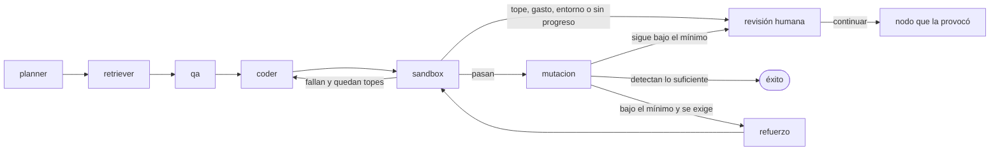

# Mapa de módulos

> Tipo: Explicación y referencia
> Última revisión: 2026-11-10 contra el commit c36b336

Qué hay en cada directorio del repositorio, qué hace cada módulo clave y dónde se extiende. Las descripciones salen de la cabecera de cada archivo. Para el porqué de las decisiones, ver los ADR en [.sdd/arquitectura/](../.sdd/arquitectura/); para el panorama de capas, [architecture.md](architecture.md).

## Directorios de primer nivel

| Directorio | Qué contiene |
|---|---|
| `core/` | El motor, en JavaScript ESM sin compilar. Sin dependencia del anfitrión (Claude Code) salvo por tres archivos compartidos con los hooks |
| `cli/` | La CLI `fragua` / `forge` / `sdd-es`. `cli/index.js` despacha; cada comando vive en `cli/comandos/` o en un archivo propio |
| `claude-hooks/` | Los hooks de Claude Code (guardián de herramientas, memoria de agentes, convenciones, contexto). Autónomos: se copian al proyecto del usuario |
| `commands/` | Los 39 comandos `/sdd.*` y `/forge`, en Markdown. Son la fuente de las skills generadas |
| `agents/` | Los 14 agentes, un Markdown con cabecera cada uno |
| `skills/` | Las 31 skills propias. `skills-generadas/` guarda una skill por comando, generada con `npm run generar-skills` |
| `plantillas/` | Plantillas de los artefactos SDD: especificación, plan, tareas, ADR, constitución |
| `presets/`, `configuracion-ejemplo/` | Los presets `lean`, `startup` y `enterprise`, y el `sdd.config.yaml` que se instala |
| `docs/`, `docs-site/` | La documentación y el sitio publicado |
| `tests/` | Un archivo `<módulo>.test.js` por módulo de `core/`, más pruebas de contrato, documentación y evaluación del guardián |
| `.sdd/` | Artefactos del propio repositorio: especificaciones, ADR, constitución, glosario. Es el método aplicado al propio proyecto |

## Dependencias entre capas

Comprobado con `grep` sobre el código el 2026-11-10:

- `core/` no importa nada de `cli/`.
- `claude-hooks/` no importa el motor, con una excepción: `claude-hooks/shared/guardian-reglas.js` y `protegidos.js` reexportan `core/evidencia/`. El instalador sustituye esos dos reexports por copias autónomas, porque `core/` no existe en el proyecto del usuario.
- En sentido contrario, `core/entorno.js` reexporta `claude-hooks/shared/entorno.js`: el punto único de lectura de las variables `FRAGUA_*` y `FORGE_*` vive en los hooks.
- Solo hay tres dependencias de npm: `@anthropic-ai/sdk`, `@sqlite.org/sqlite-wasm` y `acorn`. Añadir otra exige un ADR.

## `core/`: el ciclo verificado

El corazón del producto. Un grafo de nodos sin framework (ADR-01), cuyas transiciones son una función pura que decide por el estado y los códigos de salida, nunca por el texto de un modelo (ADR-05).

Con `motor.mutacion: no` el nodo de mutación no existe y un pase termina en éxito. El nodo de pruebas puede acabar en revisión sin pasar por el implementador si sus pruebas no fallan sin implementación. Fuente: `core/ciclo/grafo.js`.

| Módulo | Responsabilidad |
|---|---|
| `core/ciclo/index.js` | Fachada del ciclo |
| `grafo.js`, `router.js` | Aristas del grafo y decisiones deterministas (ADR-05) |
| `nodos.js` | Los nodos: planificador, recuperador, pruebas, implementador, ejecución, mutación, refuerzo y revisión |
| `estado.js`, `checkpoint-archivos.js`, `sello.js` | Estado del ciclo, puntos de guardado en archivos (ADR-04) y su sello de autenticidad |
| `presupuesto.js` | Libro de costos y tope de gasto por sesión (ADR-06) |
| `protocolo-archivos.js`, `contratos.js` | De la salida de un agente a archivos en disco, y el contrato de salida de cada agente (ADR-07) |
| `herramientas-coder.js`, `turnos.js` | El implementador por turnos y sus cinco herramientas (ADR-21) |
| `perfiles.js` | Capacidades de cada rol: herramientas, rutas, topes. El proyecto solo puede apretar, nunca ampliar |
| `control-salida.js`, `dato-no-confiable.js` | Revisión por contenido de lo que el agente escribe, y delimitador de lo que llega al modelo |
| `mutacion.js`, `pruebas-confiables.js`, `sospecha.js` | Medición de las pruebas por mutación (ADR-20) y señales de que un pase no demuestra nada |
| `candado.js`, `diario.js`, `respaldo.js`, `restos.js` | Candado entre procesos, diario de llamadas pagadas, respaldo de archivos y barrido de restos |

## `core/`: el aislamiento

| Módulo | Responsabilidad |
|---|---|
| `core/sandbox/politica.js` | Política de aislamiento convertida en argumentos de `docker run` (ADR-02) |
| `core/sandbox/docker-cli.js` | Envoltorio de la CLI de Docker |
| `core/sandbox/sandbox-runner.js`, `staging.js` | Ejecuta las pruebas en un contenedor sobre una copia desechable del proyecto |
| `core/sandbox/preparar-imagen.js` | Imagen con las dependencias declaradas, instaladas sin red en la ejecución (ADR-03) |
| `core/sandbox/diagnostico.js` | La comprobación de Docker de `fragua doctor`, con la causa del fallo |
| `core/runners/` | Un runner por lenguaje: Node, Python, Go y Rust. El ciclo verificado solo tiene imagen base para JavaScript, TypeScript, Python y Go (`core/sandbox/preparar-imagen.js`) |

## `core/`: evidencia, verificación y puertas

| Módulo | Responsabilidad |
|---|---|
| `core/verificar/` | `fragua verificar`: veredicto aislado sobre código existente, sin modelo |
| `core/evidencia/` | Cadena de informes firmados, matriz criterio a prueba, reglas del guardián y lista de configuración protegida |
| `core/puertas/` | Puertas de calidad declarables en `sdd.config.yaml`, ejecutadas en el mismo contenedor sin red |
| `core/aprobaciones-identidad.js` | Aprobaciones con terminal real, código de un solo uso y registro firmado |
| `core/estado-usuario.js` | Estado que un repositorio no puede fabricar: vive fuera del árbol del proyecto |

## `core/`: modelos, memoria y servidores

| Módulo | Responsabilidad |
|---|---|
| `core/llm-providers/` | Proveedores de modelo: Anthropic, OpenAI y compatibles, Ollama y uno de prueba. `niveles.js` define niveles neutrales (alto, medio, económico) |
| `core/precios.js` | Lista incluida de modelos y precios (ADR-19) |
| `core/recuperacion/` | Recuperación de contexto por archivos y por similitud (ADR-08) |
| `core/mcp/` | Servidor MCP por entrada y salida estándar, sin dependencias (ADR-12), con perfiles de herramientas |
| `core/api/` | API HTTP local para lanzar y decidir tareas |
| `core/integraciones/` | GitHub, GitLab y Jira ejecutadas por el anfitrión, no por el modelo (ADR-22). Un adaptador por plataforma en `proveedores/` |
| `core/instalacion/` | Perfiles de instalación, tabla de herramientas de destino y conversión de comandos a skills |
| `core/contrato/`, `core/schemas/` | Validador de un subconjunto de JSON Schema y los esquemas de los formatos públicos |
| `core/state-machine.js`, `state-store.js` | La máquina de estados del pipeline de etapas y su almacén |

## `claude-hooks/`

| Hook | Cuándo actúa |
|---|---|
| `pre-tool-guard.js` | Antes de cada herramienta: bloquea comandos destructivos, escrituras sobre secretos y configuración protegida. Falla cerrado. Es una red de seguridad, no un límite ([SECURITY.md](../SECURITY.md)) |
| `post-write-conventions.js` | Tras escribir: comprueba convenciones |
| `agent-memory.js`, `context-manager.js` | Memoria persistente de agentes y gestión del contexto |
| `ast-indexer.js`, `ast-query.js`, `query-memory.js` | Índice de código con `acorn` y consultas de memoria |
| `model-registry.js` | Detección y resolución de proveedores de modelo |

## Dónde se guarda el estado

| Dónde | Qué | Se versiona |
|---|---|---|
| `.sdd/estado.json` | Etapa del pipeline y especificación activa | Sí en este repositorio |
| `.sdd/especificaciones/`, `.sdd/arquitectura/` | Especificaciones y ADR | Sí |
| `.sdd/motor/<sesión>/` | Puntos de guardado, diario y gasto del ciclo | No |
| `.sdd/aprobaciones.jsonl` | Registro firmado de aprobaciones | No (decisión abierta en la especificación de equipos) |
| Carpeta del usuario fuera del proyecto (`estado-usuario.js`) | Clave local de firma y estado de las integraciones | Nunca |

## Dónde extender

| Quiero añadir… | Toca | Lo comprueban |
|---|---|---|
| Un agente | `agents/<nombre>.md`, `.claude-plugin/plugin.json`, y los presets | `tests/consistency.test.js`, `tests/catalogo.test.js`, `tests/agent-cabecera-tools.test.js`, `tests/consistencia-cifras.test.js` |
| Un comando | `commands/<nombre>.md`, `.claude-plugin/plugin.json`, `npm run generar-skills` | `tests/consistency.test.js`, `tests/instalacion-skills-comandos.test.js` |
| Un proveedor de modelo | `core/llm-providers/` y su registro en `index.js` | La batería de conformidad de proveedores; guía en [guia-anadir-proveedor.md](guia-anadir-proveedor.md) |
| Una puerta de calidad | La sección `puertas:` de `sdd.config.yaml`, validada por `core/puertas/config.js` | `tests/puertas-*.test.js`; guía en [puertas-de-calidad.md](puertas-de-calidad.md) |
| Una plataforma de trabajo | Un adaptador en `core/integraciones/proveedores/` que cumpla `puerto.js` | `tests/integraciones-*.test.js` |
| Un lenguaje para el ciclo | Un runner en `core/runners/` y su imagen base en `core/sandbox/preparar-imagen.js` | `tests/sandbox-*.test.js` |

Antes de cualquier cambio, el método del repositorio: especificación en `.sdd/especificaciones/`, pruebas primero y un ADR si la decisión no es trivial. Detalle en [CONTRIBUTING.md](../CONTRIBUTING.md).
