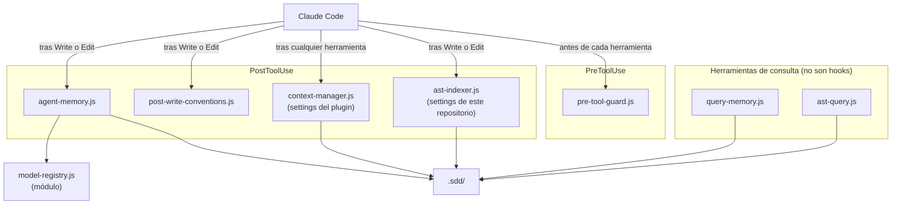
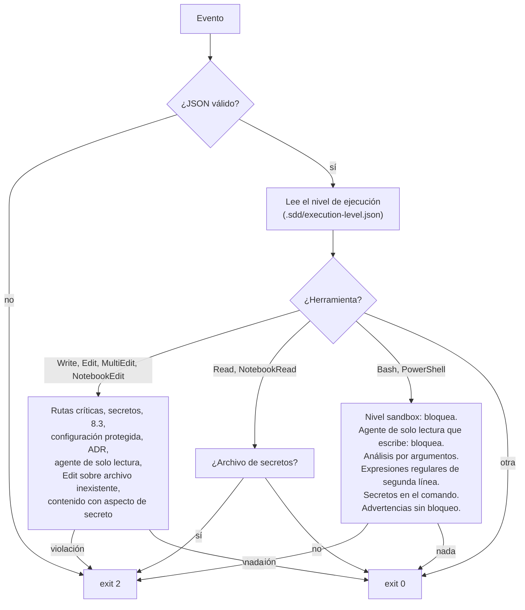
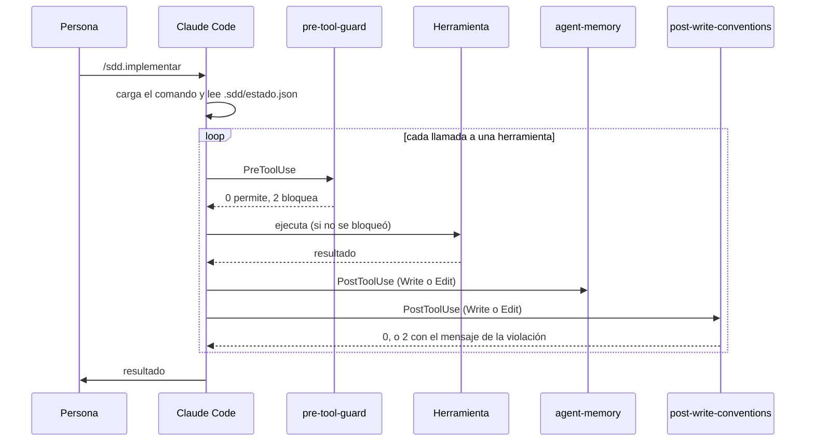

# Runtime

> Tipo: Referencia
> Última revisión: 2026-11-10 contra el commit 7683f83

Qué hace cada pieza que se ejecuta como proceso: los hooks de Claude Code, las herramientas de consulta, el panel de observación y los procesos del motor (`forge run`, `forge mcp`, `forge api`). Para el inventario y los `settings.json` véase [hooks.md](hooks.md); para el diseño, [architecture.md](architecture.md); para el estado real del proyecto, [ESTADO-ACTUAL.md](ESTADO-ACTUAL.md).

---

## Visión general



Cada ejecución de un hook es un proceso de Node independiente: arranca, lee el evento JSON de la entrada estándar, hace su trabajo y termina. No hay servidor. El estado se comunica solo a través de archivos de `.sdd/`.

Los hooks son una integración con Claude Code. El motor (`forge run`) no los usa; véase [Procesos del motor](#procesos-del-motor).

---

## pre-tool-guard.js

Hook `PreToolUse`, sin filtro de herramienta. Recibe en la entrada estándar el evento con `tool_name` y `tool_input`, y decide con el código de salida: `0` permite, `2` bloquea y muestra el motivo al agente. **Falla cerrado**: un evento ilegible, un módulo que no carga o un error interno terminan con `2`.

La lista completa de lo que bloquea está en [hooks.md](hooks.md#qué-bloquea-el-guardián). Aquí, el orden en que evalúa:



Detalles que se pasan por alto:

- **Dos mensajes distintos en la misma situación:** la mayoría de bloqueos pasan por la función `bloquear`, que además escribe en `.sdd/observabilidad/dlq.jsonl`; los de violación de ADR, agente de solo lectura en escritura, `Edit` sobre archivo inexistente, contenido con aspecto de secreto y las expresiones regulares de segunda línea salen directamente con `2` sin esa cola.
- **Auditoría:** si `CLAUDE_AGENT_NAME` está definida, cada escritura y cada comando se anotan en `.sdd/observabilidad/agent-tool-audit.jsonl`, con el comando recortado a 120 caracteres y los secretos tapados.
- **`forge.config.json`:** dos opciones de `guardrails` —`write_safety` (por defecto activa; avisa al sobrescribir con `Write`) y `verify_local_imports` (por defecto desactivada; avisa de importaciones relativas que no existen)— solo avisan, no bloquean.
- **`FORGE_EDITAR_GUARDIAN=1`** levanta únicamente la protección de las rutas críticas del guardián (véase [hooks.md](hooks.md#variable-forge_editar_guardian)).

---

## agent-memory.js

Hook `PostToolUse` sobre `Write|Edit` (el código también acepta `MultiEdit`). Se ejecuta para todos los agentes y, para los de un grupo concreto, guarda memoria. Comprobado en [agent-memory.js](../claude-hooks/agent-memory.js):

| Qué | Para quién | Dónde |
|---|---|---|
| Línea de consumo: `ts`, `agente`, `tool`, `archivo`, `bytes`, `tokens_est`, `provider`, `effort_level` | Todos | `.sdd/observabilidad/consumo.jsonl` |
| Línea de mutación: `ts`, `agente`, `archivo`, `tool`, `tipo` (`partial` para `Edit`, `full` en el resto) | Todos | `.sdd/observabilidad/mutaciones.jsonl` |
| Comentarios `ADR: {...}` del contenido escrito | Todos | `.sdd/arquitectura/ADRs.jsonl`, `.sdd/memoria/compartida/decisiones-clave.md` y el almacén de decisiones |
| Aviso si `MEMORY.md` del usuario supera 150 líneas | Todos | Salida de error |
| Entrada de memoria del agente e índice invertido | Nueve agentes: `arquitecto`, `asesor-datos`, `disenador-api`, `critico`, `desarrollador-backend`, `desarrollador-frontend`, `tester`, `documentador`, `operaciones` | `.sdd/memoria/indice.jsonl` y `memoria.db` o `agente-<nombre>.md` |

Notas:

- Sin `CLAUDE_AGENT_NAME`, el agente se registra como `main` en el consumo y no se guarda memoria por agente. (Una versión anterior de este documento decía que se registraba como «desconocido»; ese es el nombre del archivo cuando el evento no trae ruta.)
- `tokens_est` es `ceil(bytes / 3,5)` del contenido escrito, no un consumo real del modelo.
- El comentario `ADR:` se reconoce con `//`, `/* */`, `#`, `--`, `<!--` o `REM` seguido de `ADR:` y un objeto JSON **sin llaves anidadas** (la expresión regular corta en la primera `}`) que tenga el campo `decision` como texto. Los campos que aprovecha son `decision`, `context`, `alternatives` y `status`. El hook **no** crea archivos `ADR-NN-slug.md`.
- Los registros `.jsonl` rotan al superar `consumo_max_mb` (10 por defecto): se conservan hasta tres copias.

### Backend de memoria

Lo decide [claude-hooks/shared/config.js](../claude-hooks/shared/config.js):

| Condición | Backend |
|---|---|
| `memoria.backend` declarado en `.sdd/sdd.config.yaml` (`sqlite` o `markdown`) | El declarado |
| Sin declarar, Node 22.5 o superior | SQLite (`node:sqlite`, `.sdd/memoria/memoria.db`) |
| Sin declarar, Node anterior | Markdown |

Si se pide SQLite y no está disponible, cae a Markdown y lo avisa. Con Markdown, al superar `umbral_bytes` (40 000 por defecto) se comprime el archivo: se conserva una entrada por archivo y el original queda en `agente-<nombre>.original.md`. Con SQLite, cuando un agente acumula más de 10 entradas sobre el mismo archivo se conservan las 5 más recientes. El hook no invoca ninguna skill de compactación.

---

## post-write-conventions.js

Hook `PostToolUse` sobre `Write|Edit`. Solo mira archivos de código (`.ts`, `.tsx`, `.js`, `.jsx`, `.mjs`, `.cjs`, `.py`, `.rs`, `.go`, `.java`, `.kt`, `.cs`, `.rb`, `.php`, `.swift`, `.cpp`, `.c`, `.h`) de más de 9 caracteres. Reúne convenciones de cuatro fuentes y valida el archivo contra ellas.

| Fuente | Qué extrae |
|---|---|
| `.sdd/memoria/constitucion.md` | Longitud máxima de función; cobertura mínima; patrones prohibidos escritos como `NUNCA`, `PROHIBIDO` o `NO USAR` seguidos de un fragmento entre comillas invertidas |
| `.sdd/sdd.config.yaml` | `longitud_funcion_maxima` y `cobertura_tests_minima` |
| Configuración de ESLint, si existe | Estilo de comillas y de punto y coma |
| Hasta tres archivos del mismo tipo en `src`, `lib`, `app`, `pkg`, `internal` | Sangría (tabulaciones o espacios, 2 o 4) y comillas dominantes |

Qué valida realmente y con qué gravedad:

| Comprobación | Resultado |
|---|---|
| Un patrón prohibido de la constitución aparece en el archivo | Error: el hook sale con código `2` |
| Sangría opuesta a la del proyecto en más de 3 líneas | Error: código `2` |
| Comillas opuestas en más de 5 líneas (JS y TS) | Advertencia: código `0` |
| Función más larga que `longitud_funcion_maxima` | Advertencia: código `0` |

La cobertura mínima y el estilo de punto y coma se leen pero **no se validan**; tampoco se leen `longitud_archivo_maxima` ni `permitir_codigo_comentado`, que una versión anterior de este documento atribuía al hook.

**El código `2` no revierte la escritura**: el hook corre después de que el archivo se haya escrito. Lo que hace es devolver el mensaje al agente para que lo corrija. Que Claude Code interprete el código `2` de un `PostToolUse` de otra manera: no verificado más allá de lo que fija `tests/hooks-contract.test.js`.

---

## context-manager.js

Hook `PostToolUse` sin filtro de herramienta, registrado solo por la plantilla que instala el plugin. Actúa cuando el evento trae recuentos de tokens de uso (no verificado que Claude Code los incluya en este evento): los acumula en `.sdd/observabilidad/budget-state.json`, añade una línea al ledger (`consumo.jsonl`, con `costo_usd` calculado con una tabla propia de precios por token de tres modelos Claude), mantiene un resumen progresivo en `context-summary.md` y compara el gasto acumulado con dos umbrales (`BUDGET_WARN_USD`, 0,50; `BUDGET_BLOCK_USD`, 1,00). Al superar el segundo termina con código `2`. También avisa cuando el resultado de `Read`, `Bash`, `WebFetch` o `WebSearch` supera `TOOL_MAX_BYTES` (50 000). Las variables llevan prefijo `FRAGUA_` o `FORGE_` ([hooks.md](hooks.md#otras-variables-de-entorno-que-leen-los-hooks)).

Esta tabla de precios es independiente de la lista del motor ([core/precios.js](../core/precios.js)). Son dos contabilidades distintas.

---

## model-registry.js

Módulo, no hook. Lo importa `agent-memory.js` para rellenar `provider` y `effort_level` del ledger. Dado un agente, devuelve `{ provider, model, tier }` ([model-registry.js](../claude-hooks/model-registry.js)):

| Nivel | Agentes | Anthropic | OpenAI | Google |
|---|---|---|---|---|
| `high` | `arquitecto`, `critico`, `revisor`, `seguridad`, `asesor-datos`, `product-designer` | `claude-opus-4-8` | `gpt-4o` | `gemini-2.0-flash` |
| `medium` | el resto, salvo `documentador` | `claude-sonnet-4-6` | `gpt-4o-mini` | `gemini-2.0-flash` |
| `low` | `documentador` | `claude-haiku-4-5-20251001` | `gpt-4o-mini` | `gemini-2.0-flash-lite` |

Los seis agentes de nivel `high` se fijan siempre a Anthropic. Para el resto, con `OPENAI_API_KEY` definida el nivel `medium` y el `low` resuelven a OpenAI; con `GOOGLE_API_KEY` o `GEMINI_API_KEY`, el nivel `low` resuelve a Google si no hay OpenAI.

**Alcance:** esta resolución solo etiqueta el ledger de los hooks. No determina qué modelo llama el motor: `forge run` usa [core/llm-providers/](../core/llm-providers/) y `llm:` / `modelos:` de la configuración. Que la tabla del hook ofrezca un valor de Google no significa que el motor tenga proveedor de Google: no lo tiene. Una versión anterior de este documento presentaba la tabla como el mecanismo de selección de modelos y afirmaba que Google no figuraba; la tabla sí lo contiene.

---

## query-memory.js, ast-indexer.js y ast-query.js

Herramientas que se invocan con `node claude-hooks/<archivo>.js`.

**`query-memory.js`** lee `.sdd/memoria/indice.jsonl` sin cargar los archivos de memoria. Opciones: `--agente`, `--ultimas N`, `--buscar`, `--archivo`, `--stats`. Funciona con el índice JSONL, que existe con cualquier backend.

```bash
node claude-hooks/query-memory.js --agente arquitecto --buscar "auth"
```

**`ast-indexer.js`** construye `.sdd/arquitectura/ast-index.jsonl` (se sobrescribe entero en cada ejecución) con símbolos de archivos `.js`, `.mjs`, `.cjs`, `.ts`, `.tsx`, `.jsx`. Usa `acorn` y, para TypeScript, elimina las anotaciones de tipo antes de analizar; el TypeScript avanzado que no se analiza queda en la cuenta de «omitidos». Se puede invocar sobre un archivo, un directorio (`--dir`) o todo el proyecto. En este repositorio también se dispara como hook tras `Write|Edit`.

**`ast-query.js`** consulta ese índice: `--archivo <ruta> --tipo exports|imports`, `--buscar <nombre>` y `--stats`. La versión anterior de este documento mostraba opciones (`--pattern`, `--type function`, `--import`) que no existen.

```bash
node claude-hooks/ast-query.js --archivo "src/auth.ts" --tipo exports
node claude-hooks/ast-query.js --buscar "login"
```

El comando `/sdd.mapear` y las skills de indexación los usan como apoyo; no están registrados como hooks automáticos en el `settings.json` del plugin.

---

## El panel (`ui/server.js`)

Panel de observación de solo lectura sobre `.sdd/`. Se abre con `forge ui` (el puerto es 3001 por defecto; `--port N` lo cambia; `--no-open` evita abrir el navegador). Si el panel no está instalado, `forge ui` indica `forge init --ui`.

Seguridad, comprobada en [ui/server.js](../ui/server.js):

- Solo escucha en `127.0.0.1`.
- Atiende únicamente si la cabecera `Host` es `127.0.0.1:<puerto>` o `localhost:<puerto>`, y rechaza una cabecera `Origin` que no sea la propia (protección contra páginas ajenas y contra reasignación de DNS). Solo admite `GET`.
- Se cierra tras 30 minutos sin peticiones.
- Valida las rutas de los archivos estáticos para impedir salir de `ui/`.

Una versión anterior de este documento afirmaba «sin autenticación necesaria (solo loopback)» y no mencionaba la comprobación de `Host` y `Origin`.

| Ruta | Contenido |
|---|---|
| `GET /` | Panel HTML |
| `GET /assets/*`, `/src/*` | Archivos estáticos de `ui/` |
| `GET /estado` | `.sdd/estado.json` |
| `GET /tareas` | `.sdd/estado-tareas.json`, o `{ "tareas": [] }` |
| `GET /verificar` | `.sdd/verificacion.json`, o `null` |
| `GET /consumo` | Últimas líneas de `consumo.jsonl` |
| `GET /eventlog` | Últimas 50 líneas de `.sdd/events.jsonl` |
| `GET /actividad` | Últimas 50 entradas de consumo en formato legible |
| `GET /agentes` | Agentes con actividad en los últimos 60 segundos |
| `GET /agente/:nombre` | Cabecera del agente, primeras 25 líneas de su memoria y sus últimas 5 actividades |
| `GET /events` | Flujo de eventos por SSE (estado y últimas 20 entradas del registro al conectar) |

---

## Procesos del motor

Tres procesos que **no son hooks** y no necesitan Claude Code. Se describen en sus documentos; aquí solo lo que los distingue en tiempo de ejecución.

| Proceso | Qué hace | Documento |
|---|---|---|
| `forge run` / `forge resume` | Ejecuta el ciclo verificado. Códigos de salida: `0` completado, `1` fallo, `3` revisión humana pendiente, `4` aislamiento (Docker) no disponible. Sin decisión en una revisión pendiente, no se gasta nada | [ciclo-verificado.md](ciclo-verificado.md) |
| `forge mcp` | Servidor MCP por entrada y salida estándar. Perfil `completo` o `verificacion` | [servidor-mcp.md](servidor-mcp.md), [mcp-verificar.md](mcp-verificar.md) |
| `forge api` | API HTTP local en `127.0.0.1` con token; escribe en una línea JSON la URL y el token | [api-http.md](api-http.md) |

El aislamiento exige Docker. Las imágenes base están fijadas por resumen criptográfico para `javascript`, `typescript` (`node:22-alpine`), `python` (`python:3.12-slim`) y `go` (`golang:1.23-alpine`) en [core/sandbox/preparar-imagen.js](../core/sandbox/preparar-imagen.js). Existe un ejecutor para Rust en `core/runners/` (modo clásico) pero no hay imagen de aislamiento para Rust en esa lista. Docker real está probado solo en Windows con Docker Desktop; en Linux no se ha medido ([ESTADO-ACTUAL.md](ESTADO-ACTUAL.md)).

---

## Variables de entorno

Las variables propias de FORGE se pueden escribir con prefijo `FRAGUA_` (nuevo) o `FORGE_` (antiguo). Si las dos existen con valores distintos, no se elige ninguna: en las de seguridad prevalece la opción restrictiva, en las demás el motor lanza un error que nombra ambas ([core/entorno.js](../core/entorno.js)).

| Variable | Quién la lee | Efecto |
|---|---|---|
| `CLAUDE_AGENT_NAME` | `pre-tool-guard`, `agent-memory` | Agente activo; sin ella, las guardas por agente se desactivan |
| `FRAGUA_LLM_PROVIDER` / `FORGE_LLM_PROVIDER` | `core/llm-providers` | Fuerza proveedor: `anthropic`, `openai`, `ollama`, `stub` y sus alias |
| `ANTHROPIC_API_KEY` (`CLAUDE_API_KEY`), `OPENAI_API_KEY`, `OLLAMA_BASE_URL`, `OPENAI_BASE_URL` | `core/llm-providers` | Credenciales y destinos. Solo valen desde el entorno del usuario |
| `FRAGUA_LLM_HOSTS` / `FORGE_LLM_HOSTS` | `core/llm-providers` | Servidores de modelo permitidos además de los oficiales |
| `FRAGUA_UI_PORT` / `FORGE_UI_PORT` | `ui/server.js` | Puerto del panel si se arranca directamente; `forge ui --port` lo fija en la orden |
| `FRAGUA_MCP_PERFIL` / `FORGE_MCP_PERFIL` | `core/mcp` | Perfil del servidor MCP |
| `FRAGUA_DESTINOS_PERMITIDOS` / `FORGE_DESTINOS_PERMITIDOS` | `core/ciclo` | Destinos de red que el usuario permite al agente |
| `FRAGUA_PERFIL_<ROL>_<CAMPO>` | `core/ciclo/perfiles.js` | Perfil de capacidades por rol (`planner`, `qa`, `coder`) |
| `FORGE_EDITAR_GUARDIAN` | `pre-tool-guard` | Levanta la protección de las rutas críticas del guardián |
| `FORGE_TEST_DOCKER=1` | pruebas | Activa las pruebas que necesitan Docker real |
| `SDD_AUTO=1` | `commands/sdd.implementar.md` | Lo lee el texto del comando (confirmaciones); no lo lee el código de `cli/` ni de `core/` |

Los umbrales del hook `context-manager` están en [hooks.md](hooks.md#otras-variables-de-entorno-que-leen-los-hooks). La lista de variables del ciclo y de la configuración está en [configuration.md](configuration.md).

---

## Ciclo de vida de una sesión dentro de Claude Code



Es el flujo de la superficie Claude Code. `forge run` sigue otro camino —el grafo de [mapa-de-modulos.md](mapa-de-modulos.md#el-ciclo-verificado-nodos-y-transiciones)— y no pasa por estos hooks.
