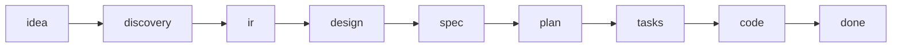

# Flujos de trabajo

> Tipo: Referencia
> Última revisión: 2026-11-10 contra el commit 7683f83

Qué etapas tiene el trabajo con Fragua, qué comando ejecuta cada una y qué comprueba el código en cada transición. Conceptos previos: [core-concepts.md](core-concepts.md). Estado del proyecto: [ESTADO-ACTUAL.md](ESTADO-ACTUAL.md).

Hay dos niveles que conviene no mezclar:

1. **Los comandos `/sdd.*`** (`commands/*.md`): textos que sigue el modelo dentro de Claude Code. Guían el trabajo, pero lo que hacen depende de que el modelo siga el texto.
2. **La máquina de estados y el ciclo verificado** (`core/state-machine.js`, `core/ciclo/`): código determinista. Las comprobaciones que no dependen del modelo están aquí.

## Máquina de estados del pipeline

Nueve pasos, definidos en `core/state-machine.js` (`TRANSITIONS`). Solo existen las transiciones de la tabla; cualquier otra se rechaza con la lista de las válidas.

| Desde | Hacia | Condición que comprueba el código |
|---|---|---|
| `idea` | `discovery` | ninguna |
| `discovery` | `ir` | `ir_generado` verdadero |
| `ir` | `design` | `ir_path` registrado |
| `design` | `spec` | `product_design_aprobado` verdadero |
| `spec` | `plan` | hay spec activa o borrador, y `spec_aprobado` verdadero (se aprueba con `fragua aprobar spec`, que exige un terminal real) |
| `plan` | `tasks` | `plan_activo` registrado |
| `tasks` | `code` | ninguna |
| `code` | `done` | ninguna |

- Se consulta y se mueve a mano, sin modelo, con `fragua status`, `fragua step <paso>`, `fragua validate` y `fragua state` ([referencia-cli.md](referencia-cli.md)).
- `fragua step <paso> --force --motivo "..."` salta las condiciones; exige un motivo de al menos 10 caracteres y deja un evento firmado `pipeline_step_forzado`.
- Los comandos `/sdd.*` registran su avance en `fase_actual` con su propio vocabulario (`descubrimiento`, `especificacion`, `tareas_generadas`, `implementacion`, `implementacion_completa`); la máquina lo traduce cuando falta `pipeline_step`. Verificación y despliegue **no** son pasos de la máquina: `code` pasa directamente a `done`.

## Los comandos, por etapa

Descripciones tomadas de la cabecera de cada archivo de `commands/`. «Perfil esencial» marca los seis comandos que instala `fragua init` sin opciones (ver [configuration.md](configuration.md#perfil-de-instalación-y-preset-lean-por-defecto)).

### Entrada

| Comando | Qué hace |
|---|---|
| `/forge` (perfil esencial) | Punto de entrada principal: tomas una idea en lenguaje natural y Fragua la especifica, construye, prueba y verifica |
| `/sdd` | Hub: lee el estado del proyecto y guía al siguiente paso; acepta intenciones en lenguaje natural y enruta al comando adecuado |
| `/sdd.construir` | Pipeline completo en un solo comando: interpreta si no hay IR, diseña si no hay diseño y luego mapea spec, planifica, genera tareas e implementa |
| `/sdd.ayuda` | Guía de comandos, flujos y agentes |

### Descubrimiento y diseño

| Comando | Qué hace |
|---|---|
| `/sdd.descubrir` | Extrae contexto mínimo cuando la descripción es vaga: preguntas concretas y un documento de contexto base antes de especificar |
| `/sdd.interpretar` | Convierte una idea en texto libre en un IR (JSON validado); orquesta discovery, interpretación y validación |
| `/sdd.diseñar` | Fase de diseño: orquesta el selector de dirección visual, `product-designer`, `architecture-designer`, el wireframe del MVP y la crítica del diseño. Requiere `.sdd/ir.json` |
| `/sdd.constitucion` | Crea o actualiza la constitución del proyecto (principios fundacionales, versionado semántico) |

### Especificación

| Comando | Qué hace |
|---|---|
| `/sdd.especificar` (perfil esencial) | Convierte una intención en una especificación con criterios de aceptación en formato Dado/Cuando/Entonces, sin detalles de implementación |
| `/sdd.aclarar` | Resuelve marcadores `[NECESITA_ACLARACION]` y ambigüedades de la spec activa con preguntas estructuradas |
| `/sdd.checklist` | Aplica un checklist de calidad a la spec activa (completitud, claridad, testabilidad, alineación con la constitución) |
| `/sdd.importar` | Importa una especificación externa (Markdown, issue de GitHub o GitLab, documento compartido) al formato del proyecto |

### Planificación

| Comando | Qué hace |
|---|---|
| `/sdd.planificar` (perfil esencial) | Plan técnico desde la spec: arquitectura, contratos de API, modelo de datos, archivos afectados, riesgos; delega en los agentes configurados |
| `/sdd.analizar` | Comprueba consistencia y cobertura cruzada entre constitución, spec, plan y tareas antes de implementar |
| `/sdd.tareas` (perfil esencial) | Desglosa el plan en tareas atómicas, ordenadas por dependencias, con criterios de verificación y agente responsable |
| `/sdd.adr` | Indexa, lista y gestiona las decisiones arquitectónicas |

### Implementación

| Comando | Qué hace |
|---|---|
| `/sdd.implementar` (perfil esencial) | Ejecuta las tareas con los agentes: todas en secuencia (sin argumentos), una concreta (por ejemplo `T003`) o `continuar` |

Para código verificado en contenedor, el camino es la CLI (`fragua run`), descrita más abajo.

### Verificación y despliegue

| Comando | Qué hace |
|---|---|
| `/sdd.verificar` | Comprueba que el código cumple los criterios de aceptación de la spec, con el agente `revisor` |
| `/sdd.qa` | Prueba el producto en un navegador real generando casos E2E a partir de los criterios de aceptación; usa un MCP de navegador |
| `/sdd.compliance` | Reporte de cumplimiento regulatorio (GDPR, SOC2, ISO 27001, HIPAA) contra el estado del proyecto |
| `/sdd.desplegar` | Despliega con verificación previa y comprobación posterior; no publica si fallan las pruebas o la verificación contra la spec, y exige confirmación explícita |
| `/sdd.canary` | Vigila un servicio recién desplegado consultando su endpoint de salud a intervalos |

### Estado, sesión y mantenimiento

| Comando | Qué hace |
|---|---|
| `/sdd.estado` (perfil esencial) | Estado actual: fase, spec activa, progreso de tareas, siguiente paso recomendado |
| `/sdd.modo` | Muestra o cambia `sesion.modo` (`normal`, `rapido`, `prototipo`) en `sdd.config.yaml` |
| `/sdd.configurar` | Ajusta `sdd.config.yaml`: agentes, modelos, comportamientos, presets |
| `/sdd.mapear` | Indexa estructura, símbolos públicos y dependencias en `.sdd/mapa/` |
| `/sdd.comprimir` | Comprime archivos para ahorrar tokens de entrada (memoria y configuración del plugin) |
| `/sdd.optimizar`, `/sdd.optimizar-memoria`, `/compact` | Alias de `/sdd.comprimir` según sus cabeceras |
| `/sdd.glosario` | Gestiona el glosario del dominio |
| `/sdd.snapshot` | Actualiza `SNAPSHOT.md` con las funcionalidades activas, tras completar una spec |
| `/sdd.release` | Calcula una versión semántica desde las specs completadas, actualiza el número de versión y el `CHANGELOG.md` |
| `/sdd.retro` | Retrospectiva ligera tras completar una feature o un despliegue |
| `/sdd.defect-report` | Reporte de calidad con tasa de escape y mutaciones |
| `/sdd.exportar` | Exporta el proyecto como bundle portable con las piezas usadas |

### Creación

| Comando | Qué hace |
|---|---|
| `/sdd.crear-agente` | Asistente para crear un agente nuevo |
| `/sdd.crear-app` | Convierte una descripción en una app web o CLI mínima, lista para `/sdd.desplegar` |
| `/sdd.crear-mcp` | Convierte una descripción en un servidor MCP empaquetado como `.mcpb`; cada criterio de aceptación se vuelve una herramienta |

Total: 39 archivos en `commands/`. Los alias `/sdd.optimizar`, `/sdd.optimizar-memoria` y `/compact` redirigen a `/sdd.comprimir`.

## El ciclo verificado

`fragua run` (motor `ciclo`, el predeterminado desde 5.0.0) ejecuta las tareas de código fuera del flujo de comandos y con comprobaciones deterministas. Detalle en [ciclo-verificado.md](ciclo-verificado.md). Lo que el código garantiza (`core/engine-cli.js`, `core/ciclo/`):

- Solo se ejecuta en la etapa `code` (o avanza solo desde `tasks`); con `--force` se salta esa comprobación.
- Cada tarea de código se corrige hasta que sus pruebas pasan, ejecutadas en un contenedor Docker sin red. Sin Docker, sale con código 4.
- Los agentes que intervienen son `arquitecto` (planifica), `tester` (escribe las pruebas) y el agente que nombra cada tarea (implementa).
- Hay un tope de gasto por sesión (2,00 USD por defecto) y, cuando una tarea no puede terminar sola, queda esperando tu decisión y el comando sale con código 3. Se decide con `fragua resume --decision continuar|aceptar|abortar`.
- Opcionalmente se miden las pruebas por mutación y se ejecutan las puertas de calidad declaradas en `sdd.config.yaml` ([puertas-de-calidad.md](puertas-de-calidad.md)).

Sin modelo, `fragua verificar` da el veredicto de las pruebas en el contenedor ([ciclo-verificado.md](ciclo-verificado.md), [cadena-de-evidencia.md](cadena-de-evidencia.md)).

## Qué pasa si algo falla

[QUE-PASA-SI-FALLA.md](QUE-PASA-SI-FALLA.md) describe los fallos por situación; [PROBLEMAS-CONOCIDOS.md](PROBLEMAS-CONOCIDOS.md) reúne los límites conocidos.

## No verificado

- Que cada comando `/sdd.*` ejecute sus pasos tal como los describen sus textos: depende del modelo que los sigue. Las pruebas automáticas del repositorio comprueban los textos de los comandos, no una ejecución real con un modelo.
- La correspondencia fina entre comandos y pasos de la máquina de estados (`/sdd.diseñar` ↔ `design`, etc.) no se ha comprobado línea a línea: los comandos escriben `fase_actual`, no `pipeline_step`.
